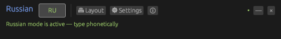
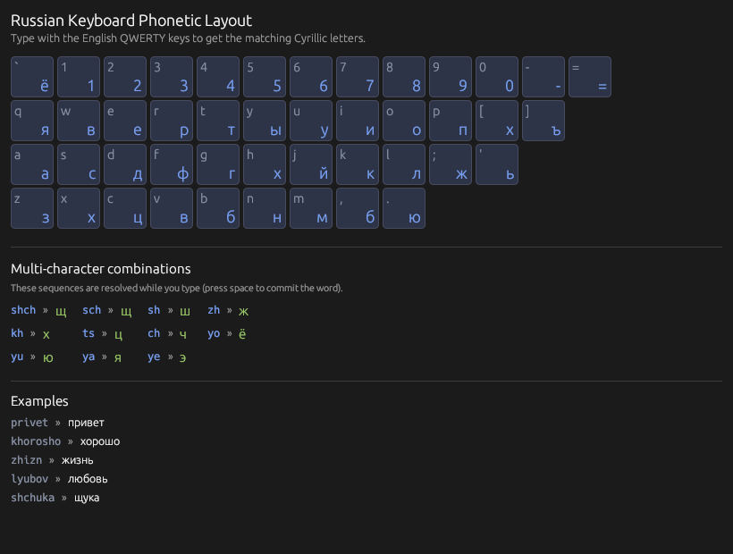
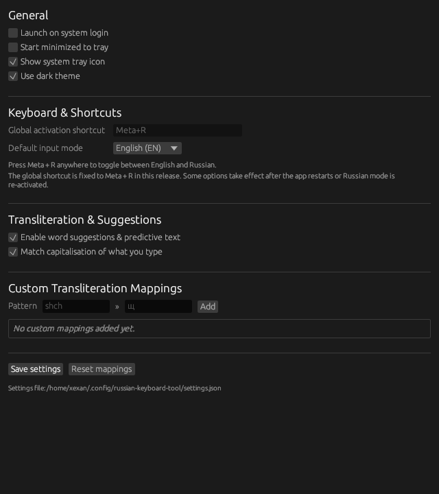
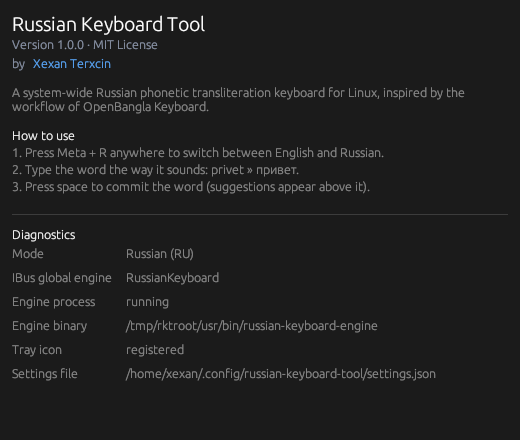

<div align="center">

# Russian Keyboard Tool

**Type Russian Cyrillic with an ordinary QWERTY keyboard — system-wide, on every Linux app.**

[](LICENSE)


[Overview](#overview) · [Screenshots](#screenshots) · [Install](#installation) · [Usage](#usage) ·
[Transliteration](#transliteration-reference) · [Building](#building-from-source) · [How it works](#how-it-works)

</div>

---

## Overview

Russian Keyboard Tool is a free and open-source Russian phonetic transliteration
keyboard for Linux. It plugs into **IBus**, so the text is composed by a real input
method — not by clipboard tricks or simulated key presses. Whatever application has
focus (Firefox, VS Code, LibreOffice, Telegram, Discord, GTK and Qt apps, …) receives
normal Cyrillic text.

Type the word the way it sounds and get Cyrillic:

| You type     | You get      |
| ------------ | ------------ |
| `privet`     | привет       |
| `khorosho`   | хорошо       |
| `zhizn`      | жизнь        |
| `lyubov`     | любовь       |
| `shchuka`    | щука         |
| `dobroe utro`| доброе утро  |

Press **`Meta + R`** anywhere to switch between English and Russian.

## Features

- **System-wide IBus input method** — works in any application that accepts keyboard input.
- **Phonetic transliteration** with multi-letter sequences (`shch` → щ, `zh` → ж, `kh` → х, `ya` → я, …).
- **Case-aware output** — `Privet` → Привет, `PRIVET` → ПРИВЕТ.
- **Word suggestions** from a bundled ~10,000-word Russian dictionary, with candidate
  selection via `1`–`9`, arrow keys, `Enter` and `Space`. Words you use are learnt.
- **Custom transliteration mappings**, editable from the settings window.
- **Top-bar controller** with the current mode, layout, settings and about windows.
- **Virtual keyboard viewer** that shows every English key next to its Cyrillic output.
- **System tray icon** with quick language switching and menu entries.
- **Lightweight and offline** — no telemetry and no network access. The engine is a
  single idle process that only does work while you type.
- **Real `.deb` package** with desktop entry, icons and IBus component registration.

## Screenshots

| Top-bar controller | Virtual keyboard |
| --- | --- |
|  |  |

| Settings | About & diagnostics |
| --- | --- |
|  |  |

## Installation

### Requirements

- A Debian-based distribution (Debian, Ubuntu, Kali, …) with **IBus** (installed by
  default on most desktops).
- X11 is recommended for the global `Meta + R` shortcut. See [Limitations](#limitations).

### From the `.deb` package

```sh
git clone https://github.com/XexanTerxcin/Russian-Keyboard-Tool.git
cd Russian-Keyboard-Tool
./scripts/build-deb.sh
sudo apt install ./dist/russian-keyboard-tool_1.0.0_amd64.deb
```

Then finish the one-time setup:

1. Refresh the IBus component cache and restart the daemon once, so the engine is
   registered with your session:

   ```sh
   russian-keyboard-setup
   ibus restart
   ```

2. Open **IBus Preferences → Input Method → Add** and pick
   **Russian → Russian Keyboard**, then add it to the list.

3. Press **`Meta + R`** and start typing.

> `ibus restart` only reloads the input daemon — it does not log you out. If you prefer,
> logging out and back in once has the same effect.

## Usage

| Action | How |
| --- | --- |
| Toggle English ↔ Russian | `Meta + R`, the top-bar `EN`/`RU` button, the tray icon, or the IBus panel |
| Commit the current word | `Space` (also types the space), `Enter`, `Tab`, or any punctuation |
| Pick a suggestion | `1`–`9`, or `↑`/`↓` then `Enter` |
| Delete the last typed letter | `Backspace` |
| Cancel the current word | `Esc` |
| Open the key map | **Layout** in the top bar |
| Change options | **Settings** in the top bar or the tray menu |

The first time you start the app it runs in English mode; enable *Launch on system
login* in the settings if you want it to start with your session.

### Configuration

Settings are stored as JSON at:

```
~/.config/russian-keyboard-tool/settings.json
```

They cover the default input mode, start-minimised behaviour, tray icon visibility,
theme, suggestions, capitalisation and custom transliteration mappings. Enabling
*Launch on system login* creates `~/.config/autostart/russian-keyboard-tool.desktop`.

## Transliteration reference

**Single letters**

| a | b | v | g | d | e | z | i | j | k | l | m | n | o | p | r | s | t | u | f | h | c | w | x | y | q |
|---|---|---|---|---|---|---|---|---|---|---|---|---|---|---|---|---|---|---|---|---|---|---|---|---|---|
| а | б | в | г | д | е | з | и | й | к | л | м | н | о | п | р | с | т | у | ф | х | ц | в | х | ы | я |

`'` → ь · `"` → ъ

**Multi-letter sequences** (resolved longest-first while you type)

| Sequence | Output | Sequence | Output |
| --- | --- | --- | --- |
| `shch`, `sch`, `shh` | щ | `zh` | ж |
| `kh` | х | `ts`, `tc` | ц |
| `ch` | ч | `sh` | ш |
| `yo` | ё | `yu`, `ju` | ю |
| `ya`, `ja` | я | `ye`, `je`, `eh` | э |

**Special words** are transliterated as a whole, including their soft sign:
`zhizn` → жизнь, `lyubov` → любовь, `den` → день.

## Building from source

Requires Rust 1.81 or newer, `cargo`, and the usual X11/OpenGL development
libraries.

```sh
# debug build
cargo build

# release build
cargo build --release

# run straight from the build directory
RUSSIAN_KEYBOARD_ENGINE=target/release/russian-keyboard-engine \
  target/release/russian-keyboard-tool
```

The `RUSSIAN_KEYBOARD_ENGINE` variable lets the GUI find a locally built engine
without installing anything.

### Tests

```sh
cargo test
cargo clippy
```

### Packaging

```sh
./scripts/build-deb.sh
```

This builds the release binaries, stages the package tree in `dist/deb-root/` and
writes `dist/russian-keyboard-tool_<version>_<arch>.deb`.

## How it works

```
┌──────────────────────────┐        IBus D-Bus API        ┌───────────────────────────┐
│ russian-keyboard-tool    │ ───────────────────────────▶ │ ibus-daemon               │
│ (GUI, eframe/egui)       │   SetGlobalEngine, status     │ (input method framework)  │
│  • top bar / tray        │                               │                           │
│  • Meta+R listener (X11) │                               │  routes key events to the │
│  • engine supervisor     │                               │  active engine            │
└────────────┬─────────────┘                               └─────────────┬─────────────┘
             │ spawns / supervises                                     │ loads
             ▼                                                         ▼
┌──────────────────────────┐       ProcessKeyEvent, CommitText   ┌──────────────────────┐
│ russian-keyboard-engine  │ ◀────────────────────────────────── │ focused application  │
│ (IBus engine, Rust)      │                                     │ (Firefox, VS Code…)  │
└──────────────────────────┘                                     └──────────────────────┘
```

- `russian-keyboard-engine` implements the IBus `Engine`/`Factory` interfaces and does
  the actual transliteration.
- On start-up it registers its component with the running `ibus-daemon` at runtime
  (`RegisterComponent`), so it becomes usable immediately instead of after a logout.
- `russian-keyboard-tool` is a thin controller: it switches the global IBus engine,
  keeps the engine process alive, and provides the GUI. The engine keeps working even
  if the GUI is closed.
- The transliteration rules live in a small, dependency-free library
  (`src/transliteration/`) that is covered by unit tests.

More detail: [`docs/ARCHITECTURE.md`](docs/ARCHITECTURE.md).

## Project layout

```
.
├── Cargo.toml                  # crate, binaries and dependencies
├── src/
│   ├── bin/engine.rs           # IBus engine binary
│   ├── bin/gui.rs              # top-bar controller (eframe)
│   ├── config/                 # persisted settings + autostart entry
│   ├── gui/                    # top bar widgets, settings window, tray
│   ├── input_method/           # IBus switching, Meta+R listener, supervisor
│   └── transliteration/        # parser, mappings, dictionary, suggestions
├── tests/                      # transliteration integration tests
├── resources/                  # word list and icons
├── packaging/deb/              # Debian package tree (control, .desktop, component XML)
├── scripts/build-deb.sh        # release build + .deb packaging
└── docs/                       # architecture notes and screenshots
```

## Troubleshooting

**Russian characters don't appear.**
Check that IBus is running and that the engine is selected:

```sh
pgrep -a ibus-daemon
ibus list-engine | grep RussianKeyboard
ibus engine
```

Re-run `russian-keyboard-setup` and `ibus restart`, then select *Russian Keyboard* in
IBus Preferences.

**`Meta + R` does nothing.**
The shortcut needs X11. On Wayland the GUI cannot grab global keys (the IBus engine
itself still works). Check that your desktop does not already bind `Meta + R` to
something else, and look at the app log:

```sh
RUST_LOG=info russian-keyboard-tool
```

**The engine is not listed in IBus Preferences.**
`ibus-daemon` reads `/usr/share/ibus/component` only at start-up. Run
`ibus restart` (or log out and back in) once after installing.

**The app starts but nothing is typed in a specific app.**
Some applications use their own input-method integration. Make sure IBus is the active
input framework for that application (for example `GTK_IM_MODULE=ibus`,
`QT_IM_MODULE=ibus`, `XMODIFIERS=@im=ibus`).

## Limitations

- **X11 for global shortcut.** The `Meta + R` grab uses X11. On Wayland, switching
  works through IBus (panel or `Super + Space`) but the global shortcut is not
  available.
- **IBus only.** The tool does not integrate with Fcitx5.
- **Fixed shortcut.** `Meta + R` is built in; the field in Settings is informational
  in this release.
- **Dictionaries.** Suggestions come from the bundled word list; there is no
  morphological analysis.

## Uninstall

```sh
sudo apt remove russian-keyboard-tool
rm -rf ~/.config/russian-keyboard-tool
```

Remove the input method from IBus Preferences if it is still listed, then run
`ibus restart`.

## Contributing

Bug reports and pull requests are welcome at
[github.com/XexanTerxcin/Russian-Keyboard-Tool](https://github.com/XexanTerxcin/Russian-Keyboard-Tool).
For code changes, please run `cargo fmt`, `cargo clippy` and `cargo test` first.

## License

Released under the [MIT License](LICENSE).

## Author

**Xexan Terxcin** — [github.com/XexanTerxcin](https://github.com/XexanTerxcin)

Inspired by the workflow of [OpenBangla Keyboard](https://github.com/OpenBangla/OpenBangla-Keyboard).
